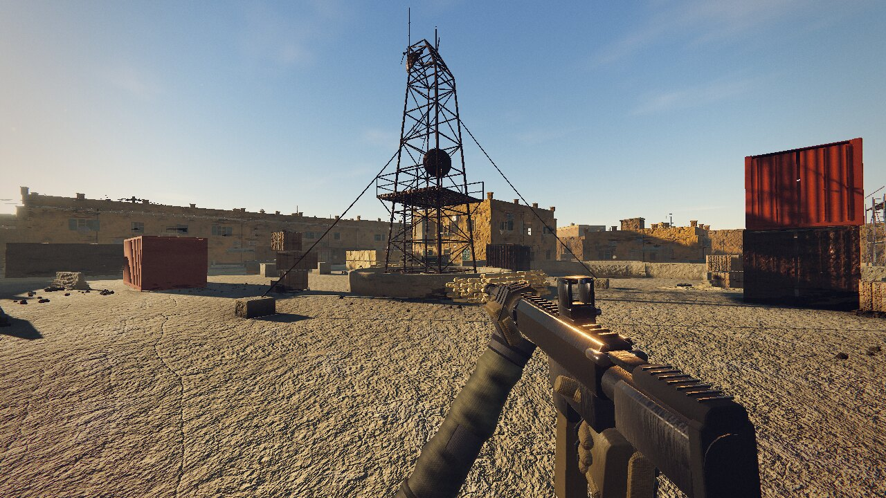
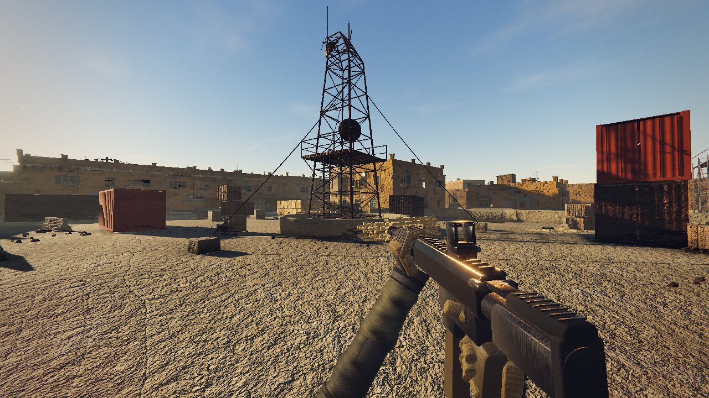
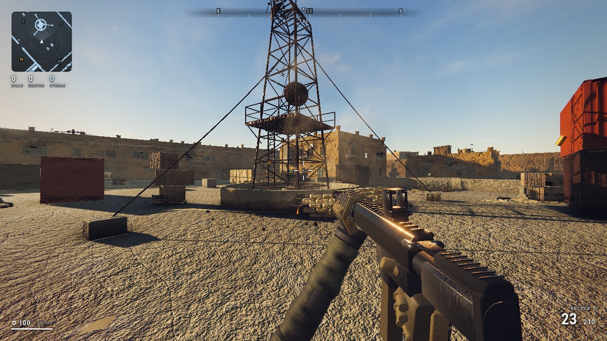
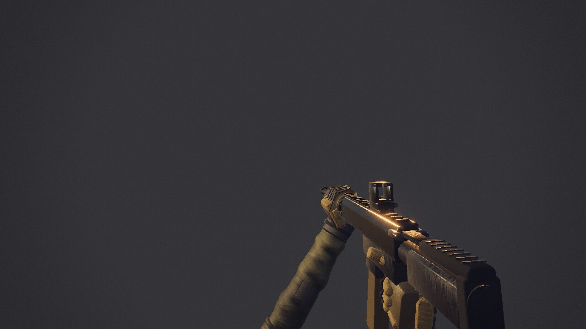

# Noisefield

A first-person shooter that runs entirely in the browser, built under one hard
constraint: **zero external assets.** There are no `.png` textures, no `.gltf`
models, no `.wav` files, no fonts, no CDN. Every texture is baked on the GPU at
load time, every mesh is generated from code, and every sound is synthesised
through the Web Audio API.

The entire shipped game is **three files** — one HTML, one JS bundle, one CSS —
totalling 1.8 MB, or 594 KB gzipped.



---

## Table of contents

- [What this is](#what-this-is)
- [Screenshots](#screenshots)
- [Getting Started](#getting-started)
- [Deploying to GitHub Pages](#deploying-to-github-pages)
- [Controls](#controls)
- [Architecture](#architecture)
- [URL parameters](#url-parameters)
- [Browser requirements](#browser-requirements)
- [How this was built](#how-this-was-built)
- [Known limitations](#known-limitations)
- [Performance](#performance)
- [Contributing](#contributing)
- [License](#license)

---

## What this is

Roughly 50,000 lines of TypeScript across 60 files, implementing:

| Subsystem | What it does |
| --- | --- |
| **Render pipeline** | Cascaded shadow maps, N8AO ambient occlusion, bloom, SMAA, motion blur, filmic grade |
| **Material forge** | 17 procedural PBR surfaces baked to GPU render targets at load — albedo, ORM, normal |
| **Sky & lighting** | Physically-derived sky, sun/ambient rig, environment probe baked at runtime for IBL |
| **World** | "Compound Zulu", a 90 × 90 m three-lane map with props and decals |
| **Weapons** | 5 weapons with distinct recoil patterns, ballistics with wall penetration, procedural viewmodel |
| **Entities** | Player controller, enemy AI, ragdoll physics |
| **Physics** | BVH-accelerated raycasting (~2.7 µs/ray) and a custom rigid-body solver |
| **VFX** | Analytic GPU particles, impact decals, tracers, ground fog, dust motes |
| **Audio** | 37 sound IDs / 95 buffers, entirely synthesised — no audio files |
| **UI** | HUD, crosshair, compass, minimap, pause menu with live quality settings |

The "no assets" rule is the interesting part. It is why the whole thing fits in
a single gzipped bundle smaller than one 4K texture, and it is also the source
of most of the difficulty — a procedural texture has to be *authored as code*,
so getting a surface to read as sun-bleached plaster is a matter of composing
noise functions rather than photographing a wall.

## Screenshots

| Environment | Interface |
| --- | --- |
|  |  |
| Golden-hour lighting, cascaded shadows | HUD: minimap, compass, health, ammo |



*The viewmodel on a neutral backdrop, rendered via `?shot=arms&isolate=1` (see
[URL parameters](#url-parameters)).*

## Getting Started

Requires Node 20 or newer.

```bash
npm install
npm run dev          # dev server at http://127.0.0.1:5173
```

Other scripts:

```bash
npm run build        # typecheck, then bundle to dist/
npm run preview      # serve the built bundle at http://127.0.0.1:4173
npm run typecheck    # tsc --noEmit
npm test             # run the test suite
npm run test:watch   # re-run tests on change
npm run check        # typecheck + tests + markdown lint
```

### Tests

271 tests run in under a second, with no browser required. They deliberately
target the failure modes that TypeScript cannot see, and each suite exists
because of a real bug found during development:

| Suite | Guards against |
| --- | --- |
| `shaders` | GLSL ES 3.00 reserved words used as identifiers. Two recipes once declared a local named `patch`; the shader failed to compile, the bake silently returned the clear colour, and two materials shipped as pure black. |
| `geometry` | Flat-shaded chamfers. `ExtrudeGeometry` is non-indexed, so `computeVertexNormals()` writes a face normal to every vertex — the fillet on all twelve edges rendered as more flat facets. The test measures the fraction of triangles with identical vertex normals. |
| `input` | An incomplete key-binding table. `ArrowRight` was missing entirely, so documented arrow-key movement could not strafe right. |
| `capture` | Unvalidated query-string input, and drift between the capture harness's weapon allowlist and the real roster. |
| `specs` | Incoherent weapon data — zero rate of fire, falloff curves that increase damage with distance, a weapon absent from the selection order. |

The two most important guards have been verified to fail when their bug is
reintroduced. A guard test that cannot fail is worse than no test, because it
produces false confidence.

`npm run build` runs `tsc --noEmit` **before** Vite, so a type error fails the
build instead of shipping a broken bundle.

Because the bundle is an ES module, it must be served over HTTP. Opening
`dist/index.html` directly as a `file://` URL will not work — browsers block
module scripts on file origins. Any static server will do:

```bash
cd dist && python3 -m http.server 8000
```

## Deploying to GitHub Pages

There is no backend. The build output is static files, so Pages is a natural
fit.

A workflow is included at `.github/workflows/deploy.yml`. To use it:

1. Push the repo to GitHub with the default branch named `main`.
2. Go to **Settings → Pages** and set **Source** to **GitHub Actions**.
3. Push to `main`. The workflow typechecks, builds, and publishes `dist/`.

`vite.config.ts` sets `base: './'` so the bundle uses relative asset paths.
This matters: Vite's default of `base: '/'` emits `<script src="/assets/…">`,
which resolves to the *user* root on a project site
(`https://<user>.github.io/<repo>/`) and 404s, leaving a black page with no
visible error. Relative paths work at a domain root, under any subpath, and
from `vite preview` alike.

The workflow uses `npm ci`, which requires `package-lock.json` to be committed.
If the build fails with "lock file not found", either commit the lock file or
change that step to `npm install`.

## Controls

Click the canvas to lock the pointer. Press <kbd>Esc</kbd> to release it and
open the pause menu.

| Input | Action |
| --- | --- |
| <kbd>W</kbd> <kbd>A</kbd> <kbd>S</kbd> <kbd>D</kbd> / arrows | Move |
| Mouse | Look |
| **Left mouse** | Fire |
| **Right mouse** | Aim down sights |
| <kbd>Space</kbd> | Jump |
| <kbd>Ctrl</kbd> / <kbd>C</kbd> | Crouch |
| <kbd>Shift</kbd> | Sprint (hold; tactical sprint after a moment) |
| <kbd>Shift</kbd> + <kbd>Ctrl</kbd> | Slide (while sprinting) |
| <kbd>R</kbd> | Reload |
| <kbd>F</kbd> | Inspect weapon |
| <kbd>1</kbd> | Primary — press again to cycle through the four primaries |
| <kbd>2</kbd> | Sidearm |
| <kbd>Esc</kbd> | Pause / settings |

There are five weapons but only two selection keys, so <kbd>1</kbd> cycles the
primary pool (assault rifle, SMG, sniper, shotgun) while <kbd>2</kbd> always
draws the pistol.

Audio will not start until you interact with the page — browsers block
autoplay until a user gesture, and clicking to lock the pointer satisfies that.

## Architecture

```text
src/
├── core/        Engine loop, event bus, input, type contracts, capture harness
├── render/      Render pipeline, sky, lighting, shaders
├── materials/   Procedural texture forge and material library
├── world/       Level geometry, props, decals
├── weapons/     Specs, weapon system, viewmodel, procedural gun models, ballistics
├── entities/    Player, enemies, AI, character models, ragdoll
├── physics/     BVH world, raycasting, rigid bodies
├── fx/          Particles, impacts, tracers, volumetrics
├── audio/       Synthesis, reverb, audio engine
└── ui/          HUD, crosshair, minimap, menu
```

Two conventions hold the thing together:

**`src/core/Types.ts` is the integration contract.** Every subsystem depends on
interfaces declared there rather than on each other, which is what allowed the
subsystems to be developed independently without constant merge conflicts.

**`src/core/Bridge.ts` wires the seams.** Systems deliberately do not reach into
one another, so a small number of cross-cutting connections are made explicitly
in one place — registering level geometry with physics, registering enemy
hitboxes so ballistics can resolve them, applying damage events, and driving the
audio listener each frame. Concentrating these in one file is what made a
handful of "everything renders but nothing interacts" bugs findable.

System registration order in `src/main.ts` is load-bearing: materials → physics
→ lighting → sky → decals → level → player → weapons → enemies → particles →
impacts → tracers → volumetrics → audio → HUD → menu → bridge → pipeline.

## URL parameters

The game ships with a deterministic capture harness, used to produce
reproducible screenshots for visual review. It is inert during normal play and
only activates when `?shot=` or `?cam=` is present.

```text
?shot=courtyard              # named camera preset
?shot=arms&isolate=1&hud=0   # viewmodel on a neutral backdrop, no HUD
?cam=-14,1.7,-14&look=6,2,4  # explicit camera position and target
```

| Parameter | Effect |
| --- | --- |
| `shot` | Named camera preset (see list below) |
| `cam` / `look` | Explicit camera position / look-at, as `x,y,z` |
| `frames` | Simulation frames to advance before capturing |
| `weapon` | Weapon to equip |
| `ads`, `fire` | Aim down sights; fire N rounds |
| `hud` | `0` hides the HUD |
| `isolate` | `1` blanks the world, leaving only the viewmodel |
| `bg` | Backdrop colour for isolate mode, as hex |

Presets: `establishing`, `courtyard`, `alley`, `market`, `rooftop`,
`interior`, `weapon`, `ads`, `combat`, `arms`, `sun`.

Quality can also be forced, which is useful for comparing settings:

```text
?shot=courtyard&tier=ultra&shadowmap=4096&ssao=0&volumetrics=0
```

Accepted: `tier`, `scale`, `shadowmap`, `cascades`, `aniso`, `fov`, `shadows`,
`ssao`, `bloom`, `volumetrics`, `motionblur`, `aa`.

The harness pins the camera every frame and steps the engine at a fixed
timestep, so the same URL produces the same pixels every run — two screenshots
differ only when the code changed. It signals completion by appending an
`#noisefield-ready` element to the DOM, which headless capture tools can wait on.

## Browser requirements

- **WebGL2** is required. There is no WebGL1 fallback.
- Tested on Chrome. Should work in any current Chromium, Firefox or Safari with
  WebGL2, though only Chrome has been verified.
- Quality auto-detects and steps down on weak hardware. The pause menu exposes
  the settings directly if you want to override it.

## How this was built

This project was written almost entirely by a large language model, driven from
a terminal-based agentic coding tool. It is worth being precise about what that
did and did not mean.

**Model:** Anthropic **Claude Opus** (`claude-opus-5`). It was run inside an
agentic CLI with filesystem access, the ability to run shell commands, and the
ability to spawn parallel sub-agents.

**The brief.** In substance: build a modern military first-person shooter in
Three.js, at the highest visual quality achievable in a browser, covering
textures, physics, lighting, visual effects, audio and UI. Develop the
subsystems in parallel, and have each one independently reviewed and iterated
on rather than self-assessed. That is a reconstruction of the original
instruction rather than a verbatim quote.

**Where the goal was adjusted.** The brief asked for a quality bar set by
commercially produced shooters, with the exit condition being that a reviewer
would prefer this one. That condition cannot be met honestly: a flagship studio
title represents on the order of a thousand person-years and tens of gigabytes
of hand-authored and photogrammetry assets, and a review loop that only stops
when a critic says "yes" either never stops or teaches the critic to say yes.
So the goal was restated as something achievable and checkable: build the most
technically serious browser shooter the constraints allow, review it with
independent critics that were not told what to conclude, and document honestly
where it falls short. See [Known limitations](#known-limitations).

**Method.** The subsystems were developed in parallel by separate agents, each
with strict file ownership so no two wrote to the same file, and each running
its own dev server on its own port. Integration was done centrally against the
type contract in `src/core/Types.ts`.

The part that actually mattered was **measurement over impression.** Visual
review by an agent looking at its own work is close to worthless — it is biased
toward what it intended rather than what it produced. The bugs that got fixed
were found by instrumenting and measuring:

- Two materials were baking to **pure black** because `patch` is a reserved word
  in GLSL ES 3.00, so the shader failed to compile and `bake()` silently
  returned the clear colour. Found by rendering the textures to a target and
  reading back pixel values.
- Every chamfer on every weapon was **flat-shaded**. `ExtrudeGeometry` returns
  non-indexed geometry, so its `computeVertexNormals()` writes a face normal to
  all three corners of each triangle. The module's own design notes said the
  chamfer highlight was "90% of what makes a shape read as machined metal" — and
  a Three.js implementation detail was silently cancelling it.
- A **heat-shimmer overlay** was washing out the entire game. It was a
  full-screen *additive* pass with depth testing off, so solid geometry read as
  translucent — you could see a wall's window line through a crate in front of
  it.
- Shadows were investigated as broken **three times** and were never broken. The
  original diagnosis came from a camera angle with no shadow caster in frame.

That last one is the honest summary of the whole exercise: an agent looking at a
render and forming an opinion is unreliable, and an agent reading a number is
not. Most of the real progress came from A/B captures, pixel readback, and
dumping live uniform values out of the running page — including one case where a
fix appeared to do nothing because the uniform being set in the constructor was
overwritten every frame somewhere else.

## Known limitations

Stated plainly, since the project sets itself a high bar:

- **This does not reach the visual quality of a commercially produced shooter.**
  It is a browser project built from procedural assets by one automated run; a
  studio title is the work of hundreds of artists over years. The gap is large
  and is not going to be closed by tuning.
- **Level design is the largest single gap**, and it is not a rendering problem.
  The map is a largely flat plain with scattered cover, where a well-designed
  multiplayer map is dense and layered with deliberate sightlines. No shader
  fixes that.
- **The heat shimmer is mitigated, not fixed.** Heat haze is *refraction*, and
  that element is a scene overlay with no access to the colour buffer, so it
  physically cannot refract. It was reduced to a faint horizon warmth; doing it
  properly means moving it into the post-processing chain as a UV distortion.
- **The hands do not survive extreme magnification.** Fingers are swept tubes
  with knuckle swells, which reads correctly at normal viewing distance but is
  visibly approximate at 5× zoom.
- **Ground texture tiling** is visible at distance.
- **Buildings are simple volumes** with largely painted-on window detail.
- **Melee and grenade are bound but not implemented.** <kbd>V</kbd>,
  middle-mouse and <kbd>G</kbd> are wired to input actions that nothing
  currently consumes, so they do nothing. They are left bound rather than
  removed because the actions are part of the input contract.
- Muzzle flash is implemented but was never visually confirmed, because the
  muzzle sits outside the frame in the capture presets used for review.

## Performance

Roughly 330–470 draw calls and 1.5–2.7 M triangles per frame depending on view,
including three shadow cascades. Comfortable on discrete GPU hardware; the
quality tier steps down automatically on weaker devices.

Note that the material forge bakes ~200 MB of GPU textures at load. This is VRAM
rather than download, but it is the reason first load takes a moment.

## Contributing

Contributions are welcome. See [CONTRIBUTING.md](CONTRIBUTING.md) for how to set
up the project, the coding conventions this codebase follows, and what to
include in a pull request. Security issues should follow
[SECURITY.md](SECURITY.md) rather than being filed as public issues.

## License

Released under the **MIT License** — see `LICENSE`.

This project is an original work and is not affiliated with or endorsed by any
game publisher. It contains no third-party game assets of any kind — no models,
textures, audio or code taken from another title. Every asset is generated
procedurally from the source in this repository, which is the entire point of
the project.
